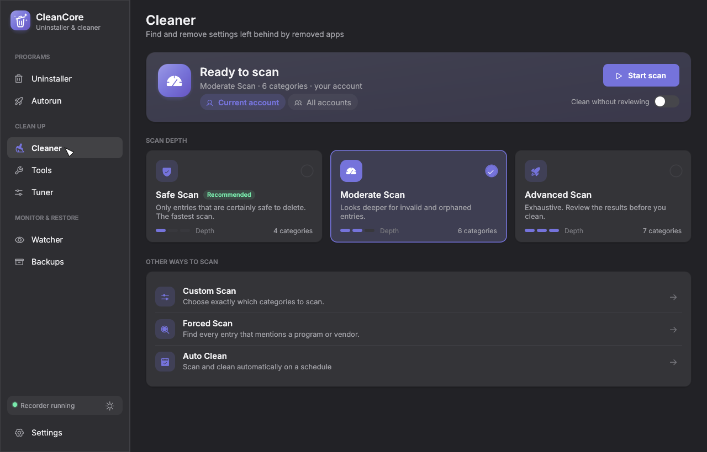
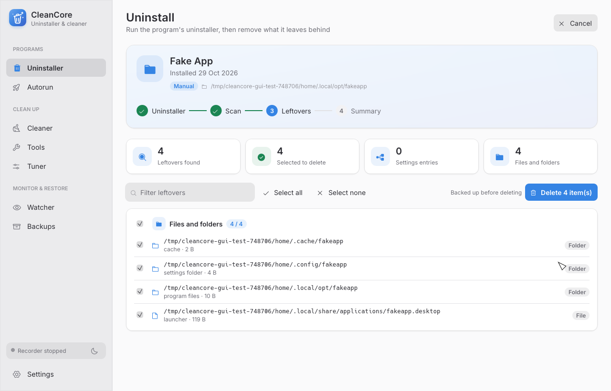

<p align="center">
  
</p>

<h1 align="center">CleanCore</h1>

<p align="center">
  A fast uninstaller and system cleaner for Linux and Windows, written in Rust.
</p>

<p align="center">
  
</p>

## Features

- **Uninstaller**: removes programs, then finds and deletes everything they left behind
- **Quick and batch uninstall**: silent uninstallers plus automatic leftover cleanup for many programs at once
- **Install and trace**: records an installation so it can be undone exactly later
- **Cleaner**: finds broken launchers, dead startup items, orphaned settings and registry entries
- **Junk files, history and evidence remover**: temp files, browser history, free space wiping
- **Duplicate finder**: identical files found fast (size, then sampled hash, then full BLAKE3 hash, all in parallel); the extra copies go to the Trash, one copy is always kept
- **Unrecoverable delete**: overwrites files before removing them
- **Autorun manager**: everything that starts with the system, in one list
- **Tuner**: reversible system tweaks
- **Watcher**: live view of every change to config files, settings or the registry
- **Backups**: everything is backed up before it is deleted, and can be restored in one click

<p align="center">
  
</p>

## Install

Download from the [latest release](https://github.com/sudo-py-dev/CleanCore/releases/latest):

| System | File |
| --- | --- |
| Windows | `cleancore-<version>-windows-x64-setup.exe`: a setup wizard with Start menu entry, optional desktop shortcut and an uninstaller in Apps & features. Or the `.zip` to run without installing. |
| Debian, Ubuntu and derivatives | `cleancore_<version>_amd64.deb` |
| Other Linux (x86_64) | `cleancore-<version>-linux-x86_64.tar.gz` |

CleanCore updates itself from Settings › Updates (or `cleancore update`), and checks every
download against the release's signature first.

## Languages

English, עברית, Español, Français, Deutsch, Русский and Українська. CleanCore follows your
desktop's language, or pick one in Settings › Appearance.

Translations are standard gettext catalogs in [`locales/`](locales). To add or fix one, edit
the `.po` file with any PO editor (Poedit, Weblate, Lokalize). After changing interface text
in the code, run `python3 locales/extract.py` to update the catalogs.

**Adding a language** needs only its catalog; no code changes:

1. Copy `locales/cleancore.pot` to `locales/<code>.po`, using the language's code (`ar`, `it`,
   `pt_BR`, `zh_CN`, …), and set `"Language: <code>\n"` in its header.
2. Optionally add `"X-Language-Name: Italiano\n"` to the header, which is the name shown in
   Settings. Common languages already have their usual name. Right-to-left languages (Arabic,
   Persian, Urdu, Hebrew, Yiddish, …) are recognized by their code; for any other language,
   `"X-Text-Direction: rtl\n"` sets the direction.
3. Translate, then rebuild. The language appears in Settings and is picked up from the desktop
   language. Right-to-left languages mirror the whole interface and their text is laid out in
   correct reading order. Scripts the bundled fonts don't cover (Arabic, Chinese, Japanese,
   Korean, Thai, Hindi, …) use a font from the system. Untranslated entries show in English.

## Build

You need a recent [Rust toolchain](https://rustup.rs).

```bash
git clone https://github.com/sudo-py-dev/CleanCore
cd CleanCore
cargo build --release
```

This builds two programs in `target/release`:

| Program | What it is |
| --- | --- |
| `cleancore-gui` | The desktop app |
| `cleancore` | The command line tool |

## Command line

```bash
cleancore scan --mode moderate     # look for problems, change nothing
cleancore clean                    # back up, then remove what the scan finds
cleancore programs                 # list installed programs
cleancore uninstall "Program Name" # uninstall and remove leftovers
cleancore junk scan                # find junk files
cleancore dupes scan               # find duplicate files (dupes clean --keep oldest|newest|shortest)
cleancore --help                   # everything else
```

## Platforms

| | Linux | Windows |
| --- | --- | --- |
| Uninstall and leftovers | deb, rpm, pacman, Flatpak, Snap, AppImage | Win32, MSI, Microsoft Store |
| Settings cleaned | config files, dconf / GNOME | registry |
| Restore points | snapper / timeshift | System Restore |

## License

[Apache 2.0](LICENSE)
