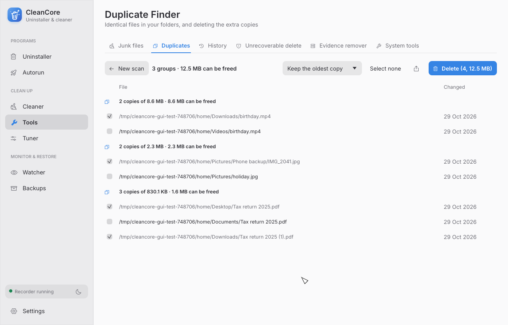

<p align="center">
  
</p>

<h1 align="center">CleanCore</h1>

<p align="center">
  Remove programs completely and keep your computer tidy. For Windows and Linux. Free.
</p>

<p align="center">
  
</p>

## What it does

- **Removes programs completely.** Most programs leave files and settings behind when you
  uninstall them. CleanCore runs the normal uninstaller, then finds what's left and removes it.
- **Frees up space.** Finds temporary files, junk and duplicate copies of the same file.
- **Makes startup faster.** Shows everything that starts with your computer, so you can turn
  off what you don't need.
- **Clears your tracks.** Deletes browser history, caches and lists of recent files.
- **Removes unwanted extras** (Windows). Takes off preinstalled apps, ads and Copilot.

## It's safe to use

- **Nothing is lost.** Everything CleanCore removes is backed up first. If something stops
  working, open **Backups** and click **Restore**.
- **You decide.** CleanCore shows you what it found before it deletes anything.
- **Start with Safe Scan.** It only removes things that are certainly safe to remove.

<p align="center">
  
</p>

## Download and install

Get the file for your computer from the
[latest release](https://github.com/sudo-py-dev/CleanCore/releases/latest):

| Your computer | Download | Then |
| --- | --- | --- |
| **Windows** | `cleancore-…-windows-x64-setup.exe` | Open it and follow the steps. |
| **Ubuntu, Linux Mint, Debian** | `cleancore_…_amd64.deb` | Double-click it to install. |
| **Other Linux** | `cleancore-…-linux-x86_64.tar.gz` | Unpack it and open `cleancore`. |

CleanCore tells you when a new version is out. You can update it from **Settings › Updates**.

## How to use it

**To remove a program:** open **Uninstaller**, pick the program and click **Uninstall**.
When it's done, CleanCore shows what the program left behind. Click **Delete** to clean it up.

**To clean your computer:** open **Cleaner** and click **Start scan**. Look over the results,
then click **Clean**.

**To free up space:** open **Tools** and choose **Junk Files** or **Duplicate Finder**.

**To start up faster:** open **Autorun** and switch off the programs you don't need at startup.

**Something went wrong?** Open **Backups** and restore what was removed.

<p align="center">
  
</p>

## Languages

English, עברית, Español, Français, Deutsch, Русский and Українська. CleanCore uses your
computer's language. To change it, go to **Settings › Appearance**.

## Questions

**Is it free?** Yes, completely, and it's open source.

**Will it break my computer?** Everything it removes is backed up and can be restored in
one click. It can also make a system restore point first (on Linux, if you use snapper or
Timeshift).

**Does it send my data anywhere?** No. It goes online only to check for updates (you can
turn that off in **Settings › Updates**) or when you ask it to, like searching the web for a
program.

---

## For developers

<details>
<summary>Build from source, command line, translations</summary>

### Build

You need a recent [Rust toolchain](https://rustup.rs).

```bash
git clone https://github.com/sudo-py-dev/CleanCore
cd CleanCore
cargo build --release
```

This builds `cleancore` in `target/release`. On its own it opens the app; with a command it
is a command-line tool:

```bash
cleancore scan --mode moderate      # look for problems, change nothing
cleancore clean                     # back up, then remove what the scan finds
cleancore uninstall "Program Name"  # uninstall and remove leftovers
cleancore dupes scan                # find duplicate files
cleancore --help                    # everything else
```

### Translations

Translations are gettext catalogs in [`locales/`](locales). Edit a `.po` file with any PO
editor (Poedit, Weblate, Lokalize). After changing interface text in the code, run
`python3 locales/extract.py`.

To add a language, copy `locales/cleancore.pot` to `locales/<code>.po`, set
`"Language: <code>\n"` in its header, translate and rebuild. No code changes are needed.
Right-to-left languages are recognized by their code and mirror the whole interface.

### What's supported

| | Linux | Windows |
| --- | --- | --- |
| Programs | deb, rpm, pacman, Flatpak, Snap, AppImage | Win32, MSI, Microsoft Store |
| Settings cleaned | config files, dconf / GNOME | registry |
| Restore points | snapper / timeshift | System Restore |

</details>

## License

[Apache 2.0](LICENSE)
